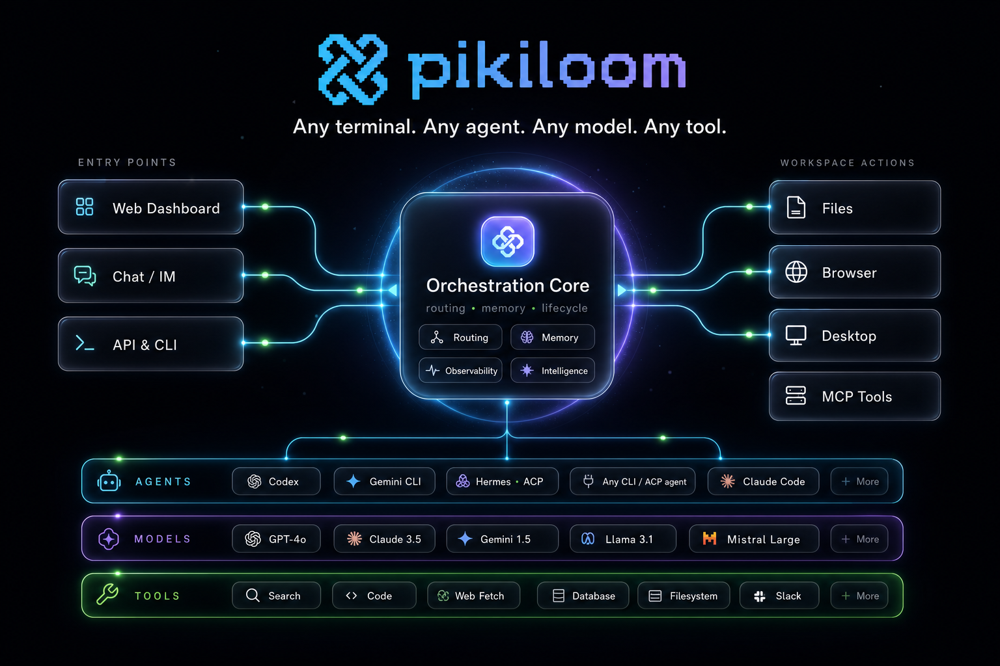

<div align="center">


## Put the world's smartest AI agents in your pocket.

##### *The open Agent orchestrator for the era when creators no longer need to read code.*

*Plug in any agent (Claude · Codex · Gemini · Hermes · …), any model (Claude · GPT · Gemini · DeepSeek · Doubao · MiMo · MiniMax · Qwen · OpenRouter · local Ollama / mlx-lm · or any OpenAI-compatible proxy), and any tool (Skills · MCP · CLI) — then drive a **swarm of them in parallel** from whichever terminal is closest: an IM, the Web Dashboard, or the CLI. swarmdeck is built with swarmdeck.*

```bash
npx swarmdeck@latest
```

<b><a href="https://xiaotonng.github.io/swarmdeck/">▶&nbsp;&nbsp;Explore the live site &amp; demos →</a></b>
</p>

</p>

<b>English</b> | <a href="README.zh-CN.md">简体中文</a>
</p>

<a href="https://xiaotonng.github.io/swarmdeck/#orchestrator"></a>

<sub><a href="https://xiaotonng.github.io/swarmdeck/#orchestrator">↗ Explore the interactive, animated version on the live site</a></sub>

</div>

---

<div align="center">

###### ENGINEERS FROM THESE TEAMS BUILD WITH PIKILOOM

**ByteDance · Tencent · Alibaba · Meta · Google · Moonshot AI · MiniMax · StepFun**

<sub>Individual engineers from these teams build with swarmdeck — real practitioners reaching for it day to day, not corporate endorsements.</sub>

</div>

---

## What is swarmdeck?

**Most "AI dev tools" settle for a narrow slice of the pie—binding you to a single IDE, a specific agent, or a closed model ecosystem.** swarmdeck is built on a fundamentally different premise: the next era of software creation won't be confined to a single code editor. It happens within an **Orchestrator** that empowers a creator to drive a *swarm* of agents—in parallel, from one console—running on the best models available, through whichever terminal is closest at hand. And you might never need to open a code file.

The product is the orchestrator itself. Everything else simply plugs in. **And what's cooler is that this orchestrator is entirely self-bootstrapped**—swarmdeck is what we use to build swarmdeck.

The diagram above maps the four layers we stitch together:

- **Entry Points** — Telegram, Feishu, WeChat, Slack, Discord, DingTalk, WeCom, the Web Dashboard, and the local API/CLI are all first-class, co-equal terminals. New ones plug right in.
- **Pluggable Agents** — Claude Code, Codex, Gemini, and Hermes ship as built-in drivers. Hermes speaks ACP (Agent Client Protocol); the registry accepts any CLI- or ACP-based agent through the same `AgentDriver` contract.
- **Model Routing** — Frontier (Claude · GPT · Gemini), Chinese domestic (DeepSeek · Doubao · MiMo · MiniMax · Qwen), local runtimes (Ollama, mlx-lm on Apple Silicon), OpenRouter, and any OpenAI-compatible proxy. Providers + Profiles are a first-class vault with a read-only `models.dev` catalog and per-agent environment injection at spawn time.
- **Tool Mesh** — Skills, MCP servers, CLI tools, web search, and desktop automation, intelligently merged across global × workspace scopes and silently injected into every session.

Sitting in the middle is the **SwarmDeck Orchestration Core** — the runtime that owns routing, memory, observability, and the bot lifecycle so any terminal can talk to any agent on any model through any tool.

---

## Built with Itself

> The most credible test of an Agent orchestrator is whether it can build itself. swarmdeck can. We use swarmdeck to develop, test, release, and operate swarmdeck—driving every commit and every release.

A typical day of development inside swarmdeck:

- A Claude Code session in pane 1 implements a new dashboard route.
- A Codex session in pane 2 writes the matching unit tests against the same workspace.
- A Gemini session in pane 3 reviews the diffs and drafts the changelog.
- Meanwhile, a background skill (`/sk_promote`) sweeps GitHub for relevant issues and automatically drafts replies in a fourth thread.
- All four streams run entirely in parallel; a single human steers them all from a phone in a coffee shop.

The orchestrator is the product. It also happens to be the ultimate IDE in which the orchestrator itself is built.

