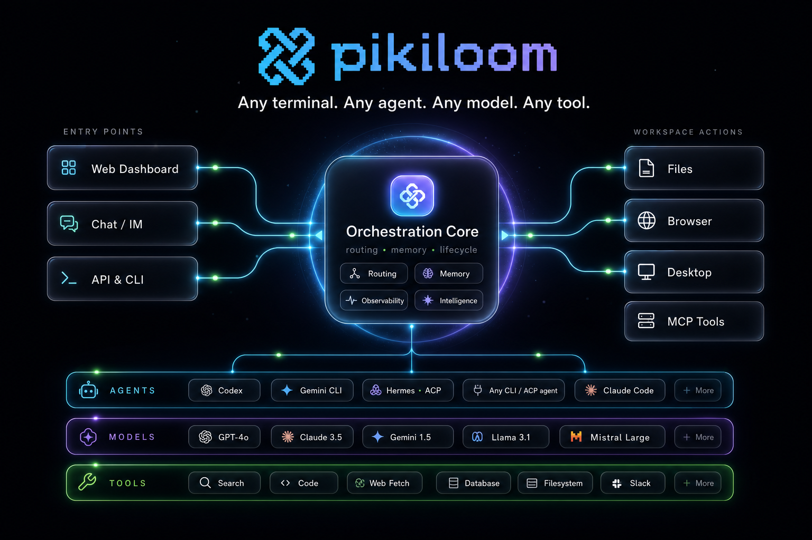
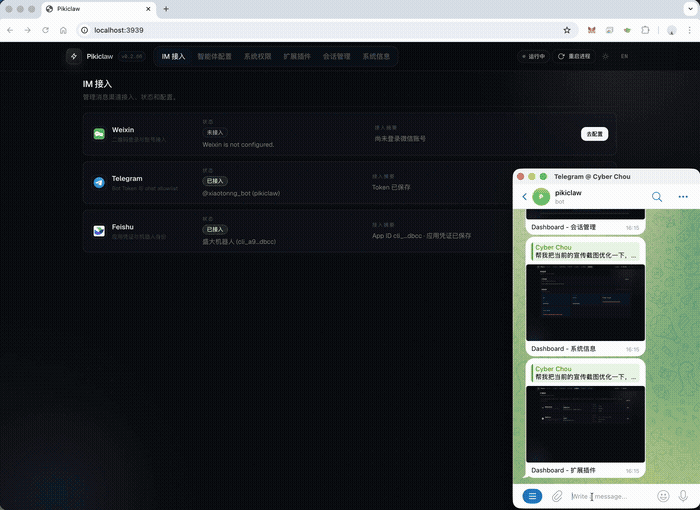

<div align="center">

# 🐾 swarmdeck

### Put the world's smartest AI agents in your pocket.

**The open orchestrator for driving a _swarm_ of coding agents — any agent, any model, any tool — from whatever screen is closest: your IM, your browser, your phone.**

```bash
npx swarmdeck@latest
```

</p>

<b>English</b> | <a href="README.zh-CN.md">简体中文</a>
</p>



</div>

---

## Drive your agents from your phone

> Ask from Telegram. The agent works on your machine. Results come back to the chat.

<p align="center"></p>

swarmdeck turns **whatever messenger you already have open** into a control surface for the agents running on your own computer. Kick off a refactor, close the laptop, steer it from a coffee shop. Same agents, same files, streamed to your pocket.

---

## What is swarmdeck?

The agents themselves are becoming extraordinary — they plan, spawn sub-agents, run their own workflows. **swarmdeck doesn't try to out-think them. It sets them free.**

It's a deliberately thin layer that wraps best-in-class agents (Claude Code · Codex · Gemini · Hermes · …) and gives them the three things they can't give themselves:

- **Reach** — drive them from any messenger or browser, not just a terminal on one machine.
- **Freedom** — run them on any model: frontier, Chinese domestic, or fully local.
- **Parallelism** — a whole swarm at once, each on its own workspace, steered by one operator.

We never rewrite the brain. When an agent ships a new capability — a workflow engine, a sharper planner, a new tool — your swarmdeck sessions inherit it **the same day, for free**. Our job is everything *around* the agent: the terminals, the models, the tools, and the orchestration across them. The orchestrator is the product — and it's **built with itself**.

> **Thin on purpose.** As the frontier agents get smarter, swarmdeck gets stronger — for free. We never race the brain; we widen its reach.

```
            ┌─────────────────────────────────────────────┐
