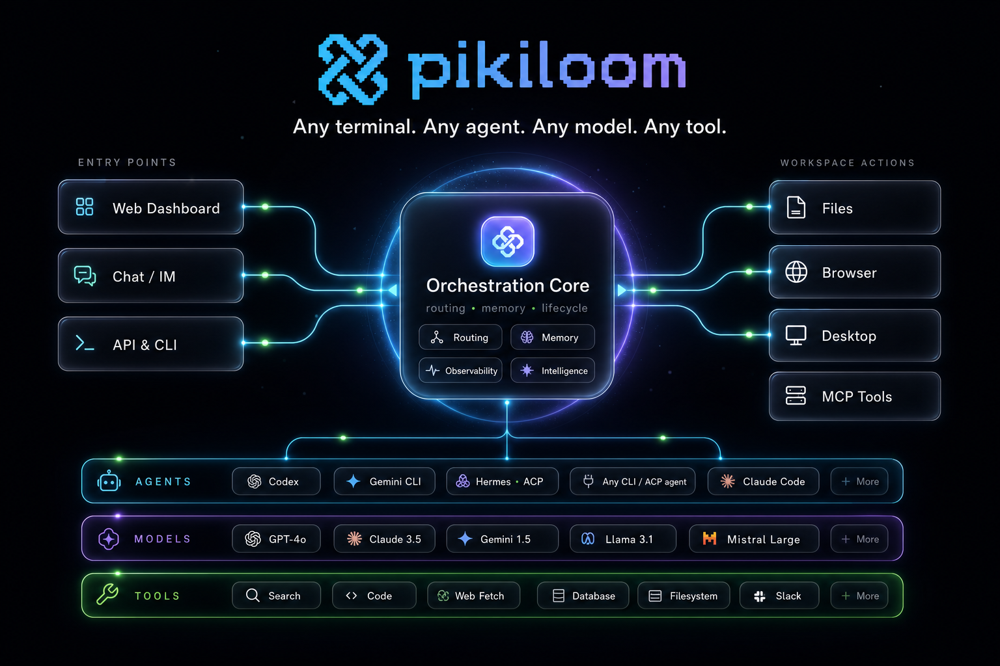

<div align="center">


## 把全世界最聪明的 AI Agent 装进你的口袋。

##### *面向「创作者不再需要看代码」时代的开放式 Agent 编排器。*

*接入任何 Agent（Claude · Codex · Gemini · Hermes · …），任何模型（Claude · GPT · Gemini · DeepSeek · 豆包 · MiMo · MiniMax · OpenRouter · 甚至是任意第三方代理），以及任何工具（Skills · MCP · CLI）。通过你最顺手的终端（IM、Web 或未来形态）来驱动它们。swarmdeck 本身就是用 swarmdeck 构建的。*

```bash
npx swarmdeck@latest
```

<b><a href="https://xiaotonng.github.io/swarmdeck/">▶&nbsp;&nbsp;访问在线站点 &amp; 演示 →</a></b>
</p>

</p>

<a href="README.md">English</a> | <b>简体中文</b>
</p>

<a href="https://xiaotonng.github.io/swarmdeck/#orchestrator"></a>

<sub><a href="https://xiaotonng.github.io/swarmdeck/#orchestrator">↗ 在线站点上有可交互、带动效的完整版本</a></sub>

</div>

---

<div align="center">

###### 这些团队的工程师都在用 swarmdeck 构建

**字节跳动 · 腾讯 · 阿里巴巴 · Meta · Google · 月之暗面 · MiniMax · 阶跃星辰**

<sub>来自这些团队的工程师在日常工作中使用 swarmdeck —— 是真实的个人实践者，而非公司层面的官方背书。</sub>

</div>

---

## swarmdeck 是什么？

**大多数「AI 开发工具」往往只做局部的创新 —— 绑定一款 IDE、单一 Agent 或某家模型厂商，然后便止步于此。** swarmdeck 则建立在一个截然不同的判断之上：下一代「创造」的过程，不会局限在某个单一的编辑器内部。它会发生在一个**编排器 (Orchestrator)** 中。在这里，创作者可以并发出一个 Agent **集群 (Swarm)**，让它们跑在当前最强大的模型上，并通过手边最方便的终端来掌控全局——而且，你甚至不需要打开任何代码文件。

核心产品就是这个编排器，其它所有组件都可拔插。**更酷的是，这个编排器是由它自己构建出来的** —— swarmdeck 就是我们用来开发 swarmdeck 的工具。

上面这张架构图勾勒出我们缝合在一起的四层结构：

- **入口层 (Entry Points)** —— Telegram、飞书、微信、Slack、Discord、钉钉、企业微信、Web Dashboard，以及本地 API / CLI，都是一等公民级别、地位完全对等的终端。新增任意一个新终端，对其它通道完全无感。
- **可插拔 Agent (Pluggable Agents)** —— Claude Code、Codex、Gemini、Hermes 均作为内置驱动。Hermes 走 ACP (Agent Client Protocol) 协议；任何 CLI 或 ACP 形态的 Agent 都可通过相同的 `AgentDriver` 契约接入注册表。
- **模型路由 (Model Routing)** —— 前沿系列（Claude · GPT · Gemini）、国产矩阵（DeepSeek · 豆包 · MiMo · MiniMax · Qwen）、本地推理（Ollama，以及 Apple Silicon 上的 mlx-lm）、OpenRouter，以及任意 OpenAI 兼容代理。Providers + Profiles 作为一等公民的凭据保险箱，自带只读的 `models.dev` 目录与启动时的逐 Agent 环境变量注入。
- **工具网 (Tool Mesh)** —— Skills、MCP 服务器、CLI 工具、Web Search、桌面自动化等，会在「全局 × 工作区」两个维度智能合并，并悄悄注入到每一次会话之中。

这一切的正中央，是 **SwarmDeck Orchestration Core** —— 由它来统一管理路由、记忆、可观测性和 Bot 生命周期，从而保证任何终端都能借助任意工具，让任意 Agent 跑在任意模型上。

---

## 自举：用自己构建自己

